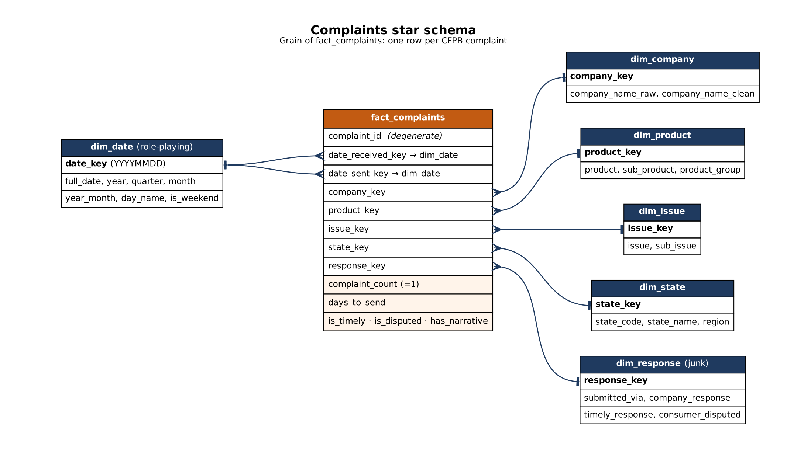

# Complaint Intelligence Copilot

A secure RAG + agent copilot that helps a bank's support agents research escalated complaints and answers
their questions with citations.

**Status.** Phase 1 (data engineering) is complete (2026-10-06). The RAG and agent phases come next.

## The scenario

I am a Forward Deployed Engineer embedded with the customer support team of a fictional retail bank. Support
agents spend too long researching escalated complaints across a legacy case system, complaint exports, and
regulatory guidance. This project builds a secured RAG + agent copilot that answers their questions with
citations.

**Client data.** Public CFPB Consumer Complaint Database (stand-in for the bank's complaint export) plus public
CFPB regulatory PDFs. Snapshot used: 2026-10-05, 18,191,687 complaints from 2011-12-01 to 2026-10-05.

## Phase 1 results (Days 1-7)

| Day | Topic | What I built | Headline result |
|---|---|---|---|
| 1 | FDE role and setup | Repo, client scenario, job-posting scorer with tests, 15 real FDE postings | 13 engineering, 1 mixed, 1 sales-disguised role |
| 2 | Advanced SQL | DuckDB loader, 8 business queries, SQL drills | 18M rows loaded in 42 s; all 8 queries under 0.5 s |
| 3 | Query performance | Postgres in Docker, benchmark tool, 4 indexes, 1 materialized view | Lookup by ID 26,266 ms → 2.4 ms; one index made a query slower |
| 4 | Legacy databases | SQL Server in Docker, legacy schema, read-only login, parameterized client, 15 security tests | Injected text matched all 50,000 cases as SQL text, 0 as a parameter |
| 5 | Data modeling | Star schema (1 fact, 6 dimensions), 6 validation checks, ER diagram | Averaging trap: 74.22% vs the real 99.55% |
| 6 | Medallion layers | Bronze → Silver → Gold pipeline, seeds, data-quality report | Manual review caught wrong company merges; 8,144 spellings → 8,123 companies |
| 7 | dbt | 13 models, 5 seeds, 62 data tests, 1 unit test, docs | PASS=80, WARN=1, ERROR=0; matches Day 6 to the row |

More detail: [PHASE1_SUMMARY.md](PHASE1_SUMMARY.md) (results and lessons),
[LEARNINGS.md](LEARNINGS.md) (daily log), [ASSUMPTIONS.md](ASSUMPTIONS.md) (data decisions).



## Tech stack

| Area | Tools |
|---|---|
| Analytics database | DuckDB |
| Query performance | Postgres 16 in Docker |
| Legacy case system | SQL Server 2022 in Docker, SQLAlchemy + pyodbc, SOAP demo (zeep) |
| Modeling | Star schema, medallion layers (Bronze / Silver / Gold) |
| Transformation | dbt (DuckDB adapter) |
| Testing | pytest, dbt data and unit tests |

## Repository layout

| Path | What it is |
|---|---|
| `jd/` | Job-posting scorer and postings (Day 1) |
| `data/load_duckdb.py`, `run_sql.py`, `sql/analysis.sql`, `sql/drills.sql` | DuckDB loader and SQL queries (Day 2) |
| `docker-compose.yml`, `perf.py`, `sql/pg/`, `plans/`, `perf_table.md` | Postgres performance work (Day 3) |
| `docker-compose.legacy.yml`, `data/legacy/`, `data/legacy_schema.md`, `tests/test_readonly.py` | Legacy SQL Server access (Day 4) |
| `sql/star_*.sql`, `docs/star_schema.*` | Star schema (Day 5) |
| `data/medallion/` | Bronze → Silver → Gold pipeline and data-quality report (Day 6) |
| `data/dbt_complaints/` | dbt project (Day 7) |
| `outputs/` | Saved outputs of the drills and queries |

## Run it

Needs Python 3 and Docker Desktop. Download the CFPB complaints CSV from the
[CFPB website](https://www.consumerfinance.gov/data-research/consumer-complaints/) and save it as
`data/raw/complaints.csv`. There is no requirements file yet; the scripts use duckdb, pandas, SQLAlchemy,
psycopg, pyodbc, zeep, pytest and dbt-duckdb.

```bash
python data/load_duckdb.py                  # Day 2: CSV -> data/complaints.duckdb
python run_sql.py sql/analysis.sql          # run the business queries

docker compose up -d                        # Day 3: Postgres
python data/load_postgres.py
python perf.py bench --tag before           # time the queries

cp .env.example .env                        # Day 4: set the SQL Server passwords
docker compose -f docker-compose.legacy.yml up -d
python data/legacy/setup_legacy.py

python data/medallion/run_pipeline.py       # Day 6: Bronze -> Silver -> Gold + DQ report

cd data/dbt_complaints && dbt build --profiles-dir .   # Day 7

pytest                                      # from the project root
```
